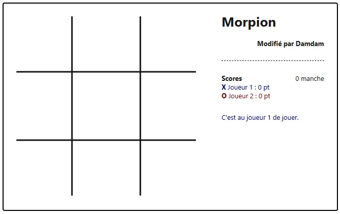
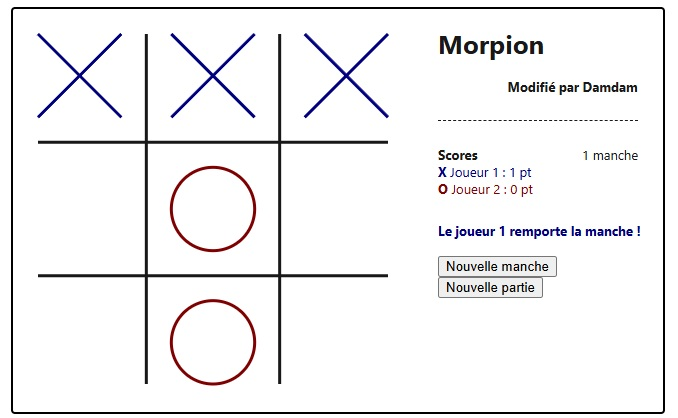
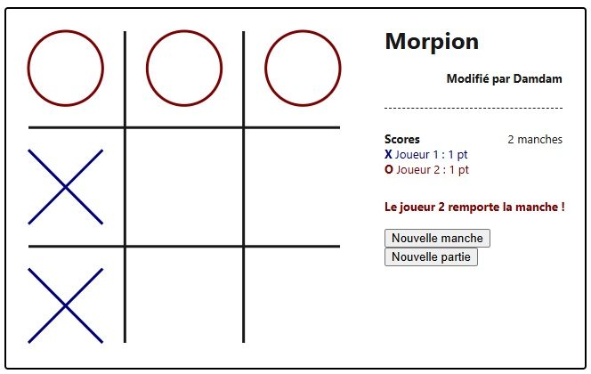

Consignes
Afin de compléter et corriger le code vous devrez :
Trouver les 3 erreurs dans le code HTML
Quelques exemples d'affichages pour vous aider :

Coder la fonction theEnd(player) dont le paramètre est un entier correspondant au joueur ayant remporté la manche et qui effectue les traitements suivant :
Retirer l'aspect joueur (rond ou croix) du curseur.
Changer la valeur de l'attribut isTheEnd pour représenter la fin de partie.
Comptabiliser la manche.
Mettre à jour l'élément affichant le nombre de manche·s.
Afficher un message dans l'élément prévu à cet effet pour signaler quel joueur a gagné et ajouter les boutons pour une nouvelle manche et une nouvelle partie. Penser à ajouter l'attribut onClick appelant la fonction reliée.
Augmenter l'attribut de score du joueur qui a gagné.
Mettre à jour le score affiché.
